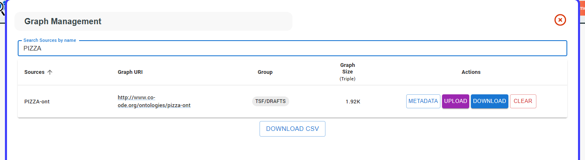
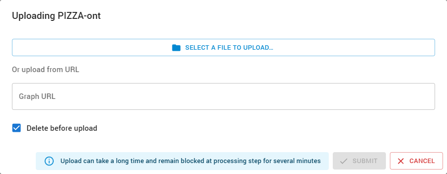
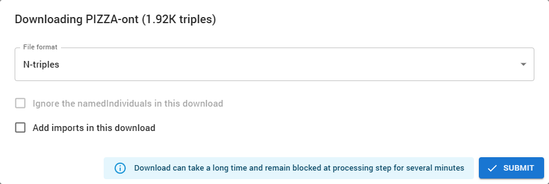
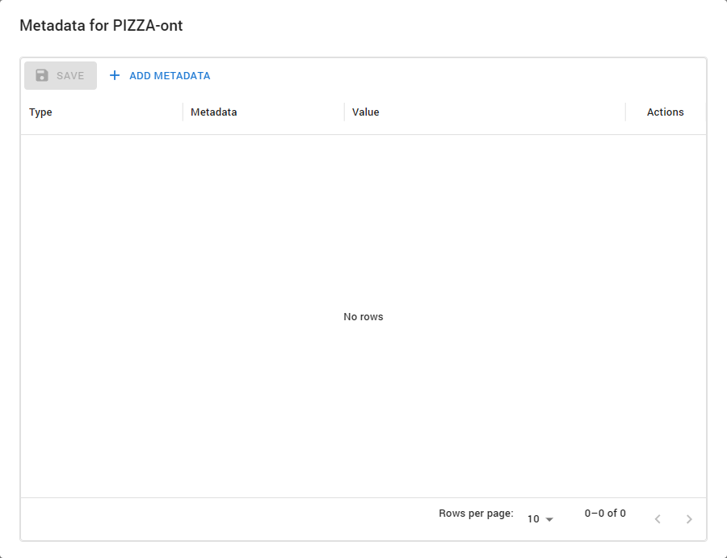
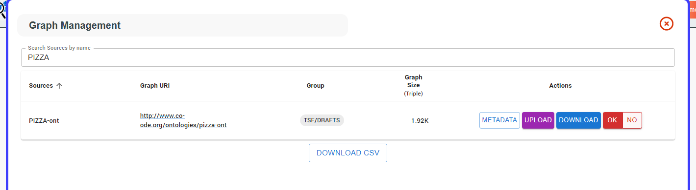

# GraphManagement

GraphManagement is the tool for managing the RDF graphs of the sources in SousLeSens. It lists the sources you can read, with the size of their graph, and lets you upload, download, describe and clear each graph.

```{contents} Table of Contents
:depth: 3
```

## Overview

Open **GraphManagement** from the **Tool** menu of the top panel.



- **Search Sources by name** filters the list.
- The table shows, for each source, its name (**Sources**), its **Graph URI**, its **Group** and its **Graph Size**, in triples. Click a column title to sort the list.
- The **Actions** of each row are **Metadata**, **Upload**, **Download** and **Clear**. **Upload** and **Clear** are only active if you have **readwrite** access to the source.
- **Download CSV**, under the table, downloads the list of the sources with their graph URI and their size.

## Uploading a Graph

1. Find the source in the list and click **Upload** on its row.

   

2. Choose what to upload:

    - **Select a file to upload…** picks a file on your computer, or
    - **Or upload from URL**: type the address of the file in **Graph URL**.

3. **Delete before upload** is checked by default: the triples already in the graph are deleted first, and the graph is replaced by the file. Uncheck it to add the triples of the file to the graph.

4. Click **Submit**. A progress bar shows the upload, then **Processing** while the triple store loads the file, and **Completed** at the end. A large graph can stay on **Processing** for several minutes. **Cancel** stops the upload.

If the file contains blank nodes, a message tells you so: the blank nodes are converted to URIs, and the links between them may not be kept exactly.

## Supported RDF Formats

| Format    | Extension | MIME Type               |
| --------- | --------- | ----------------------- |
| N-Triples | `.nt`     | `application/n-triples` |
| Turtle    | `.ttl`    | `text/turtle`           |
| RDF/XML   | `.rdf`    | `application/rdf+xml`   |
| OWL/XML   | `.owl`    | `application/owl+xml`   |
| N3        | `.n3`     | `text/n3`               |
| TriG      | `.trig`   | `application/trig`      |

## Managing Existing Graphs

### Download a Graph

1. Click **Download** on the row of the source.

   

2. Choose the **File format**: **N-triples**, **RDF/XML** or **Turtle**. RDF/XML and Turtle need the SousLeSens Python API (`sls-py-api`), and are not offered for graphs above a size limit: use N-triples for them.
3. Optionally check:
    - **Ignore the namedIndividuals in this download**, to leave the individuals out,
    - **Add imports in this download**, to add the graphs of the sources imported by this one.
4. Click **Submit**. A large graph can take several minutes.

### Metadata of a Graph

**Metadata** shows the metadata of the graph (title, description, version...) as a table of **Type**, **Metadata** and **Value**.



**Add metadata** adds a row. Change the rows, then click **Save** to write them in the graph.

### Clear a Graph

1. Click **Clear** on the row of the source. The button is disabled if you do not have **readwrite** access to the source.
2. The button turns into **OK** and **NO**: click **OK** to confirm, **NO** to cancel.

   

> **Warning**: This action cannot be undone. All the triples of the graph are permanently deleted. The source itself stays, with an empty graph.

### Replace a Graph

Upload the new file with **Delete before upload** checked: the old triples are deleted, then the new file is loaded.
