# MappingModeler

The **MappingModeler** tool is one of the main components of
**SousLeSens**, a web application for managing ontologies and knowledge
graphs built around the Semantic Web framework.  
It is designed to create semantic knowledge graphs from SQL database
sources or CSV data.

```{contents} Table of Contents
:depth: 3
```

## UI overview

### Terms

**Source**: The current source launched in the tool. It is displayed in
the top panel. MappingModeler only opens a source that you can write to.

**Data Source**: The original data, either a CSV file or a SQL database
connection. A data source holds one or more **tables** (a CSV file is one table).

**Mappings**: The semantic model built from a table. It is a graph of
**nodes** and **edges**: nodes represent resources, edges represent properties
between them. Mappings are saved automatically after every change.

**Nodes**

A node can be of five types, drawn by the legend of the Column Mappings tab:

**Column**: A column of the table.

**RowIndex**: Represents each row of the table, shown as a **#** node. It is
useful when each row carries meaningful information and must be referenced
explicitly. A table has at most one RowIndex node.

**VirtualColumn**: An intermediate or implicit object that is not
explicitly described in the table. It often corresponds to a group of columns
whose combination conveys additional information, for example a job
acquisition event that is implied but has no column of its own.

**URI**: A resource with a fixed URI, the same for every row.

**Class**: A class of the ontology model of the source or of its imports.

**Edges (or Properties)**

**Object Property**: A relationship between two resources.
When you link two columns, MappingModeler suggests the properties allowed by
the ontology model.

**Datatype Property**: An attribute that links a resource to a **literal**
value (string, integer, date...). Datatype properties are set in the
*Technical Mappings* tab and do not appear on the Column Mappings graph.

**URI syntax**

Each column gets the URI of its resources in one of three ways:

- **fromLabel**: the URI is built from the value of the column (Base URI + value).
- **blankNode**: the resources have no URI, they are blank nodes.
- **randomIdentifier**: each resource gets a random URI (Base URI + random identifier).

### Global Overview

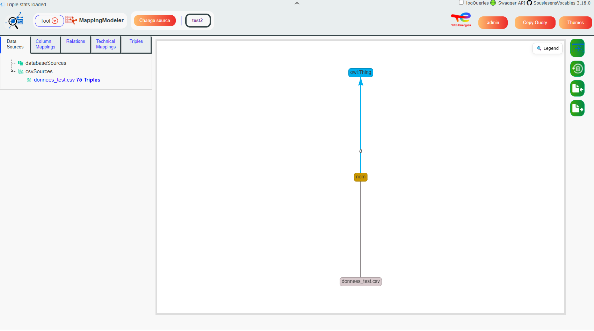

The MappingModeler UI is structured around three main components:

- **Left Panel with five tabs**: *Data Sources*, *Column Mappings*,
  *Relations*, *Technical Mappings* and *Triples*. All tabs except Data
  Sources need a table to be selected first, otherwise they answer
  `select a table`.

- **Whiteboard**: the graph of the mappings of the current table.

- **Right Panel**: buttons acting on the whole mappings.

The **Top Panel** is shared across all tools. It also shows the name of
the current table. For more information, refer to the *Global Overview*
section of the Lineage user documentation.

### Left Panel : Data Sources Tab

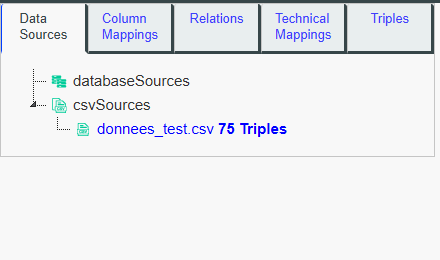

This tab is shown when MappingModeler opens. It lists the data sources of
the source, grouped in **databaseSources** and **csvSources**. A table that
already produced triples is shown in blue, with its number of triples.

Click a table (or a CSV file) to make it the current table: MappingModeler
then opens the Column Mappings tab on it.

Right-click menus:

- on **databaseSources**: **addDatabaseSources**, to add a database,
- on **csvSources**: **add Csv Sources**, to upload a CSV file,
- on a table or a CSV file: **show SampleData** (a sample of the data) and
  **delete tableMappings** (deletes the mappings of this table, after two
  confirmations),
- on a data source: **delete DataSource**. For a CSV file, the file is
  deleted too.

See the *Add Data source* tutorial sections for the details.

### Left Panel : Column Mappings

This tab builds the **structure** of the mappings: which columns are mapped,
to which classes, and how they are linked.

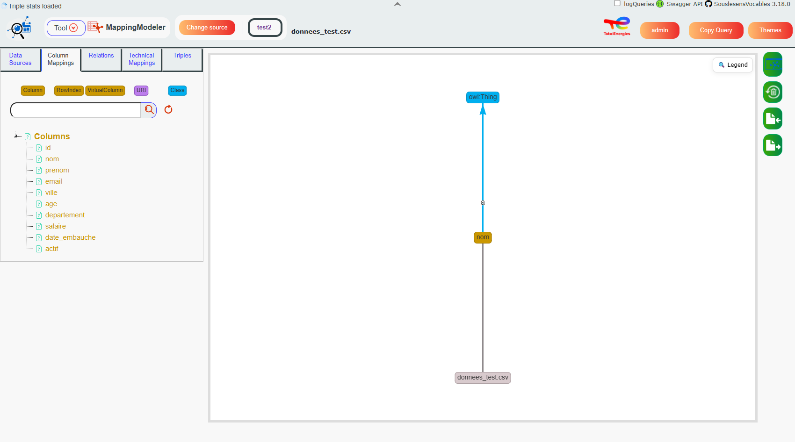

The legend at the top of the tab creates the nodes. Click an element of the
legend:

- **Column** lists the columns of the table. Click a column to add it to the
  whiteboard: the list of classes opens at once, to give it a class.
- **RowIndex** adds the **#** node of the table.
- **VirtualColumn** asks for the **Virtual column name**, then adds the node.
- **URI** starts a small assistant: choose the class (rdf:type) of the
  resource, then **enter resource label**.
- **Class** lists the classes of the source and of its imports, grouped by
  source. The first entry, **_Create new Class_**, creates a new class. For a
  large ontology, the **SEARCH...** entry asks for the beginning of the class
  name (`*` or `%` search inside the name).

Clicking a class links the current column to it with `rdf:type` (or with
`rdfs:subClassOf` if the column holds classes).

Under the legend:

- **Search bar**: filters the list.
- **Refresh** (the circular arrow): reloads the ontology model of the source,
  after classes or properties were changed outside MappingModeler.

Right-click in the list:

- on a column: **showSampleData** shows the data of the table,
- on a class of a source you can edit: **deleteClass**.

**Linking two nodes**

Hold **Ctrl** and click two nodes of the whiteboard:

- a column, then a class: the column gets this class (`rdf:type`),
- a column, then another column: the list shows the properties allowed by
  the ontology model between their classes. It starts with
  **_Create new ObjectProperty_**, **function**, **values Of column**,
  **_rdfs:member_**, **_rdf:type_** and **_rdfs:subClassOf_**. The properties
  that match an existing restriction of the model are highlighted in yellow
  and are reused as they are.

Both columns must have a class first, and they must belong to the same table.

**Right-click on a whiteboard node**

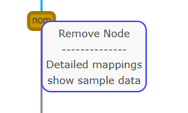

- **Remove Node** / **Remove Edge**: removes the node or the edge from the
  mappings.
- On a column: **Detailed mappings** opens the technical mappings of the
  column in a window, and **show sample data** shows the data of the table.
- On a class: **Node Infos** (see the Node Infos section of the Lineage user
  documentation) and **draw superClass**.

### Left Panel : Relations

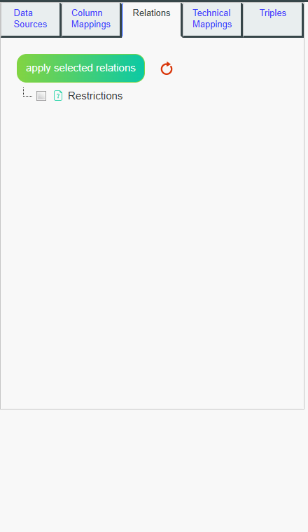

This tab lists, under **Restrictions**, the relations that the ontology model
allows between the columns of the table, grouped by source, in the form
`column-property->column`, with their kind of restriction. The relations
already drawn are greyed out.

Tick the relations you want and click **apply selected relations**: they are
added to the whiteboard, and MappingModeler returns to the Column Mappings
tab. The circular arrow reloads the ontology model.

### Left Panel : Technical Mappings

This tab completes the mappings with technical details: how the URIs are
built, the type and the label of the resources, datatype properties,
transforms and lookups. Visit it after the structure is done in the Column
Mappings tab.

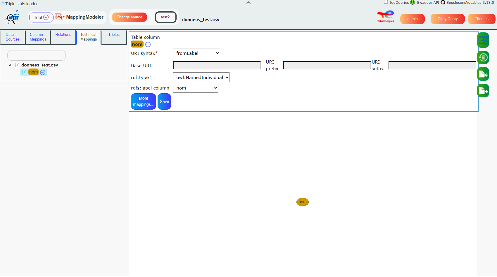

The tree on the left lists the mapped nodes of the table. Under each node,
its technical mappings are listed. Right-click a technical mapping to
**edit transform**, **edit lookup** or **delete** it.

Click a node of the tree to open its form:

- **URI syntax\***: **fromLabel**, **blankNode** or **randomIdentifier**
  (see *Terms*).
- **Base URI**, **URI prefix** and **URI suffix**: the parts of the URI, around
  the value of the column. They are only shown for **fromLabel**. If the Base
  URI is empty, the graph URI of the source is used.
- **rdf:type\***: **owl:NamedIndividual** or **owl:Class**. It can also be
  left empty for specific uses.
- **rdfs:label column**: the column whose values give the labels of the
  resources. It can be left empty.
- **set as mainColumn**: only shown when the same column is also defined in
  another table, to choose which table defines it.
- **More mappings...**: saves the form, then opens an assistant to add
  mappings: **add predicate** (an annotation or datatype property, with its
  datatype and, for dates, their format), **add rdf:Type**,
  **add rdfs:subClassOf**, **add owl:EquivalentClassColumn**, **add transform**,
  **set column as datatypeProperty**, **create  datatypeProperty**,
  **add LookUp**, **end**.
- **Save**: saves the form.

When a column of a class is first opened, its form is filled with the values
of the other columns of the same class.

### Left Panel : Triples

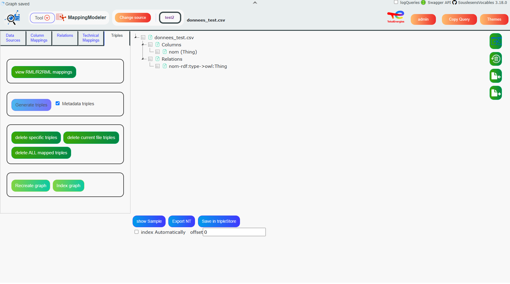

This tab turns the mappings into triples, deletes them, and indexes them.

- **view RML/R2RML mappings**: exports the mappings as a Turtle file in the
  standard **RML (SQL + CSV)** or **R2RML (SQL only - Ontop)** format. R2RML is
  not offered when all the data sources are CSV files.
- **Generate triples**: opens, on the right, the list of the mappings of the
  current table, as **Columns** and **Relations**. Tick what to run, then:
    - **show Sample**: shows a sample of the triples (500 at most), without
      writing anything,
    - **Export NT**: downloads the triples as an N-Triples file,
    - **Save in tripleStore**: writes the triples in the graph of the source.

  Options: **index Automatically** indexes the graph after writing, and
  **offset** starts from a given row. The mappings that use blank nodes must
  be ticked together.
- **Metadata triples** (checked by default): also writes the creation date
  (`dcterms:created`) of each resource.
- **delete specific triples**: deletes the triples of the ticked mappings,
  with **Show sample** to check them first and **Delete triples**.
- **delete current file triples**: deletes the triples created from the
  current table.
- **delete ALL mapped triples**: deletes all the triples created by
  MappingModeler for this source.
- **Recreate graph**: choose the tables, then **Recreate**: their triples are
  deleted and created again. MappingModeler asks whether to index the graph
  at the end.
- **Index graph**: indexes the triples of the source so that the other tools
  can search them. It asks for confirmation, then lets you choose the
  properties to index.

### Right Panel : Mappings buttons


1. **Classes graph**: draws the classes of the source and their hierarchy.
2. **Clear all Mappings**: deletes all the mappings, after two confirmations.
3. **Import**: imports mappings from a JSON file exported by SousLeSens. The
   data sources they use must exist in the source.
4. **Export**: exports the mappings as a JSON file.

There is no Save button: the mappings are saved automatically after every
change.

### Shortcuts

When you right click the tree of the **Technical Mappings** tab, you get
different options depending on the mapping: **delete** for all mappings,
**edit transform** for a transform, **edit lookup** for a lookup.

## Tutorial

Let’s open the Mapping Modeler tool in SousLeSens, and select the source
HR\_MODEL\_ACADEMIC\_TP source.

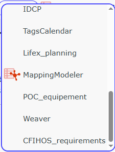

Now, the **Mapping Modeler** tool opens.  
Right-click on the **csvSources** section in the Data Sources tree, then
choose **add Csv Sources**. In the upload window, click **Select a file to
upload…**, choose your CSV file, then click **Submit**.


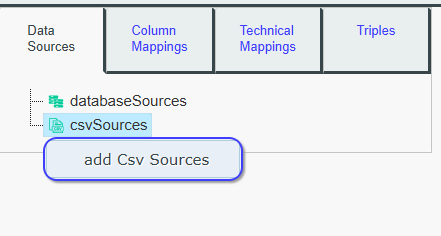 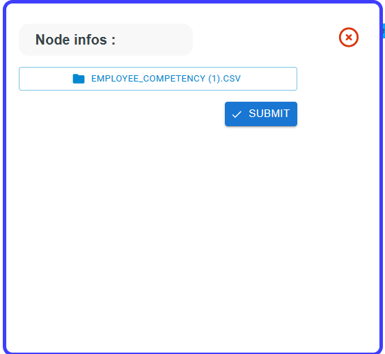

Your file is now imported into the **Mapping Modeler** tool and appears
in the data source tree.  
Click on it to select it as the **current data source**, so you can
start defining mappings on it.

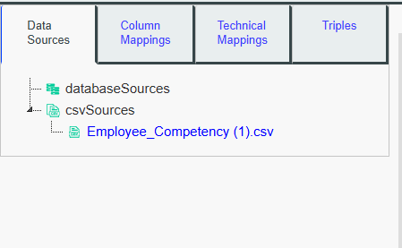

When you click on it, the **Column Mappings** tab automatically opens
and lists all the columns from your file.  
Now, click on **Employee**.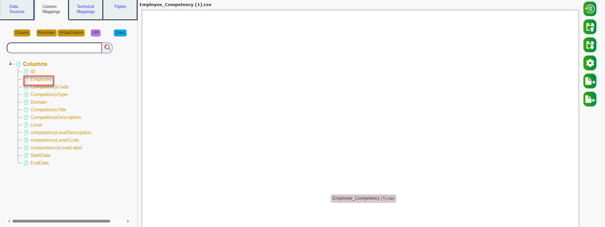

The **column node "Employee"** will now appear on the mappings graph.  
Next, click on **Person** to link the **Employee** column node to the
**Person** class node.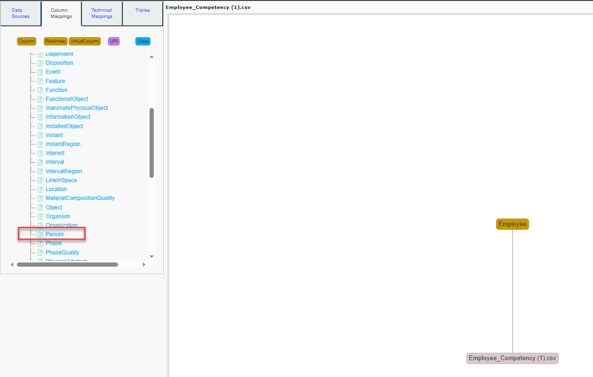

Your mappings whiteboard should now appear as illustrated in the
image.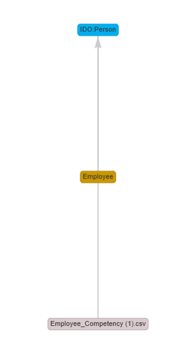

**Now, let’s create a virtual column node named gainOfCapability.**  
Click on **VirtualColumn** in the legend, then enter gainOfCapability in
the popup that appears. A new node named **GainOfCapability** will be
added to the mappings whiteboard.

**Note:**

- Virtual columns appear as **orange squares**.

- Regular column nodes appear as **orange rectangles**.

- Class nodes are displayed as **blue rectangles**.

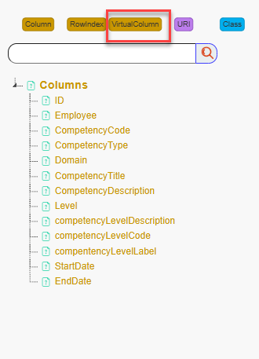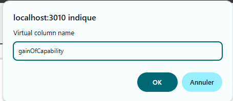
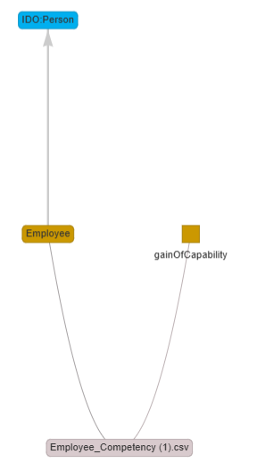

**After creating the virtual column**, the search panel will list
available classes to link it to. Since no class corresponds, we will
create a new one.  
Click on **_Create new Class_**. A bot popup will appear.  
Fill in the **Label** field with GainOfCapability, and set it as a
**subClass of** IDO:Activity..

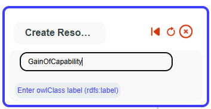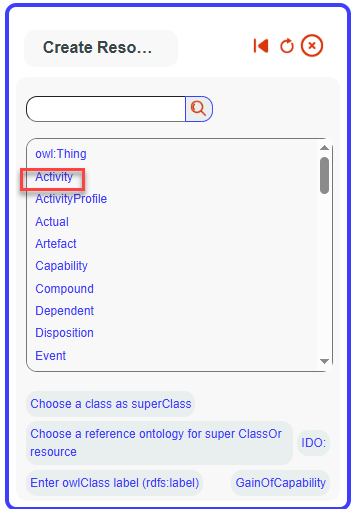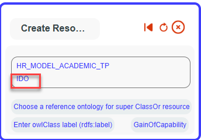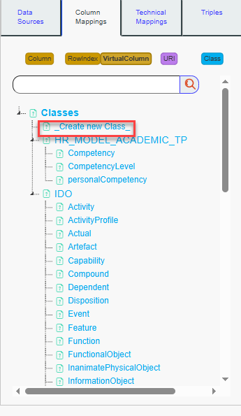

The new class is added to the tree. Click on it to select it.Your
mappings whiteboard should now appear as illustrated in the image.

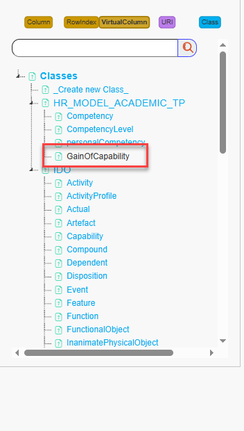 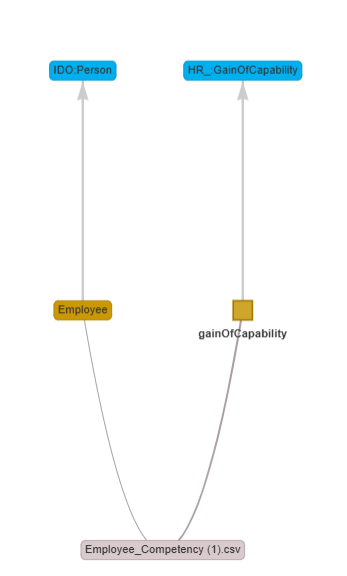

Now, Ctrl+Click on "Employee" and then Ctrl+Click on "gainOfCapability."
Authorized properties based on ranges and domains to link both nodes
will be displayed on search panel. We can see that "participantIn" is a
semantic match, but we want to be more specific and use the property
"gainsCapability" to link the nodes. To do this, we will add a new
Object Property by clicking on **\_Create new
ObjectProperty\_**.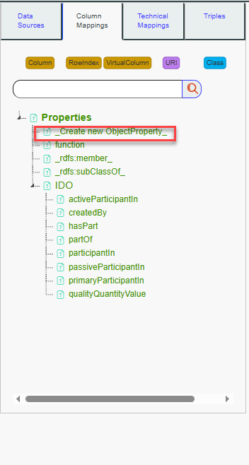

Then, a bot will appear. Fill in the label with "gainsCapability" and
set it as a subProperty of "IDO:participantIn."

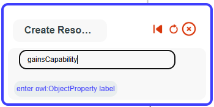 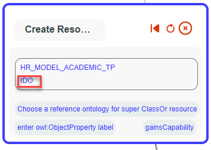
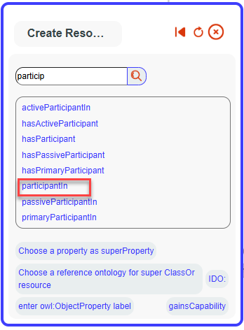

The new property will now appear, and you can select it. Once selected,
the link between the two nodes will be created.

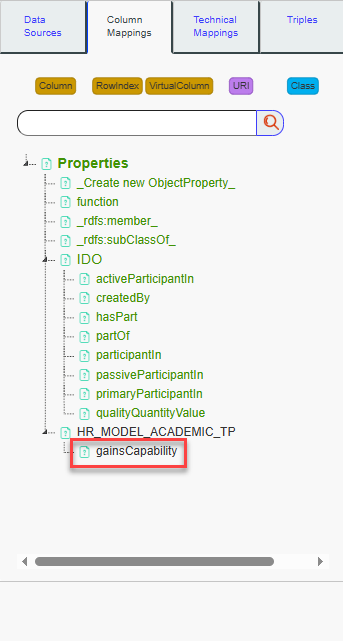 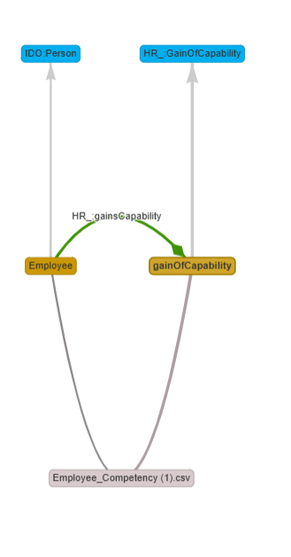

You can directly select *participantIn* or another property from this
menu if needed. Now, let's add the technical details necessary to
properly run the mappings.

Select the *Technical Mappings* tab. The mappings whiteboard will
display the mappings in a more technical and exhaustive way

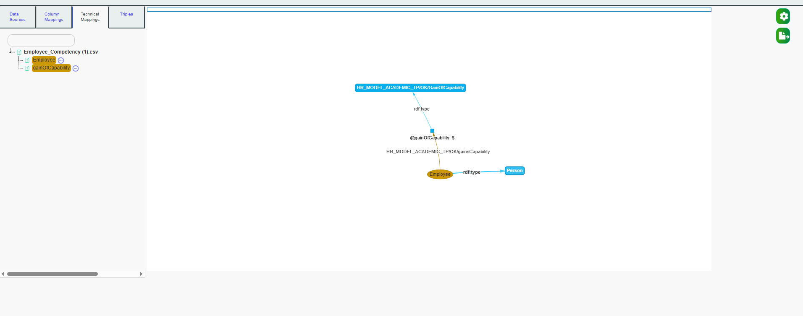

To run the mappings, we now need to fill in the basic technical mappings
so that the SLS API has the necessary information to execute the
mappings correctly.

To begin, click on *Employee*.

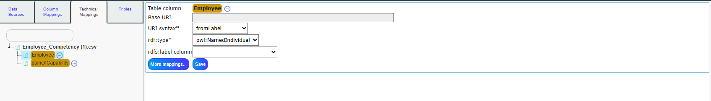

The form of the column will appear. The URI syntax will be set
to *fromLabel*, meaning that for each specific value in the Employee
column, the URI created will be the baseURI (equivalent to graphURI if
not filled) + the cell value.

For example, if the first row value of the Employee column is "Peter",
the URI created will be:
http://totalenergies.fr/data/prenoms-metiers-competencies#HR\_MODEL\_ACADEMIC\_TP/Peter

The values in the Employee column represent Individuals of the Person
class, meaning each value is an instance of the Person class. In this
case, we fill the *rdf:type* as *owl:NamedIndividual* because Peter is
an instance of the Person class.

For each Employee value, the label will be the value itself. So, for
example, Peter’s label will be "Peter". Therefore, we fill *rdfs:label*
with the value of Employee.

Note that the label is not always directly in the column itself. For
example, we could build the URI from an ID column, and the label could
come from the Employee column.

Once these mappings are filled in, you can save your changes by clicking
on Save.

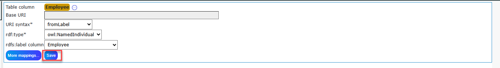

The detailed mappings for the Employee column will be set like
this.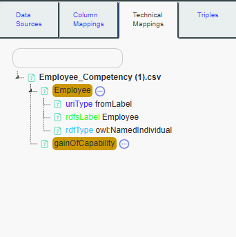

You can modify the detailed mappings for the Employee column at any time
by clicking on it again and updating the information as needed. You can
also delete a specific detailed mapping by right-clicking on it.

Now, let's proceed with the same process for the **gainOfCapability**
virtual column. Click on it to access its detailed mapping panel.

Since gainOfCapability is a virtual column, it does not have cell values
directly associated with it. The purpose of this virtual column is to
make explicit the concept that a person will gain a competency over
time. This information is implicit in the CSV file but needs to be
represented explicitly in the semantic knowledge graph.

\- **Blank Nodes**: For virtual columns, it is recommended to use
**blank nodes**. Blank nodes are typically used for intermediary
resources, which is the case for gainOfCapability. By definition,
virtual columns are intermediary nodes and thus benefit from being
represented as blank nodes.

\- **Individuals**: For each row, the **gainOfCapability** event (e.g.,
when a person gains a new competency) will be an instance of the
**gainOfCapability** class.For example, if Peter gains a new competency,
that specific event is considered an instance of the
**gainOfCapability** class.

\- **rdfs:label**: Since the event represented by **gainOfCapability**
does not have a direct name in the data (as it's implicit), the
**rdfs:label** is not filled in for this virtual column.

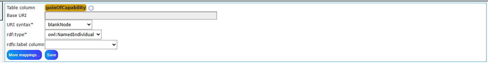

Once you have filled these details, you can save the mappings for the
**gainOfCapability** virtual column.Here the detailed mappings.

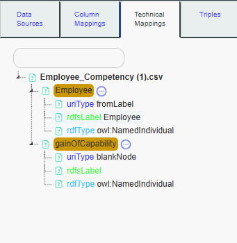

To describe the event of the **gain of capability** along with the
**start date** in our knowledge graph, we need to link the
**gainOfCapability** event with a **dateTime** information. This can be
done by creating a new **Datatype Property**.

Click on the **gainOfCapability** virtual column in the detailled
mappings tree to select it.

After selecting the **gainOfCapability** virtual column, click on
**More mappings...**. It saves the form, then opens an assistant with the
additional mappings.

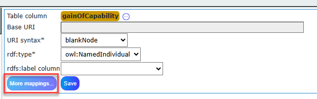

Click on **create  datatypeProperty**. The assistant first asks for the
source where the property is created: choose HR\_MODEL\_ACADEMIC\_TP.

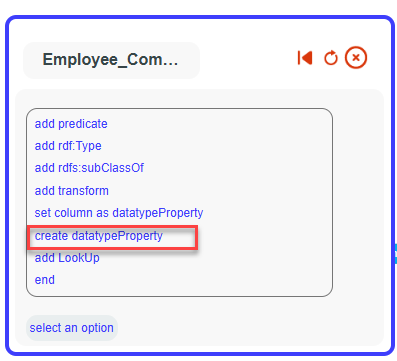

Set the label ‘gainOfCapabilityDate’ for our datatype property.

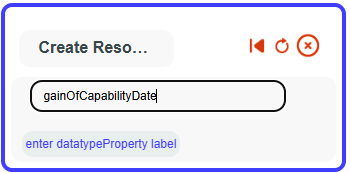

Select xsd:dateTime

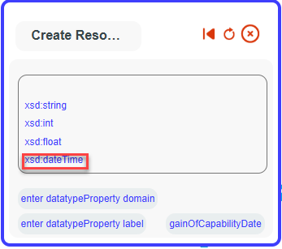

Our datatype property is now created. We will associate it with our
virtual column. Click again on **More mappings...**


Then on **add predicate**.

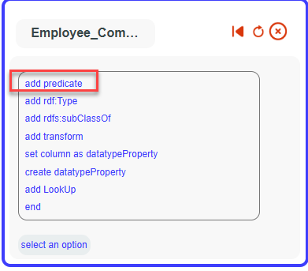

In **Choose annotation property**, open the HR\_MODEL\_ACADEMIC\_TP
source

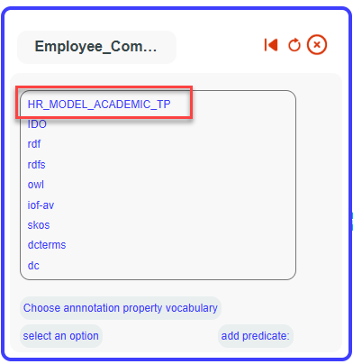

and pick your new datatype property

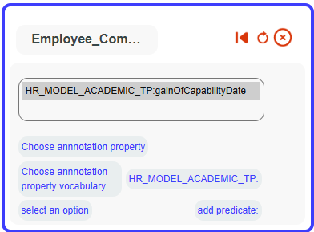

In **Choose a datatype**, select **xsd:dateTime**, then the date format
**FR : DD/MM/YYYY hh:mm:ss**, then the **startDate** column for the values.  
*(Make sure to choose the correct format based on how dates appear in
your data column.)*

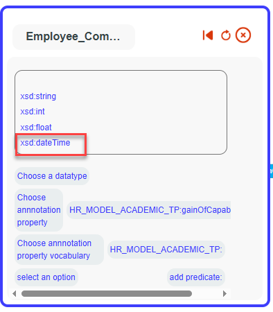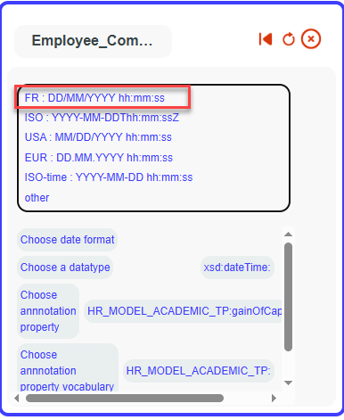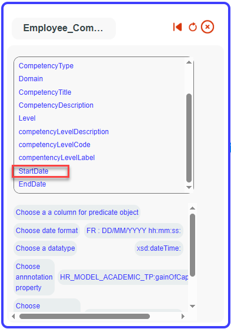

Your date has been successfully added to your
mappings.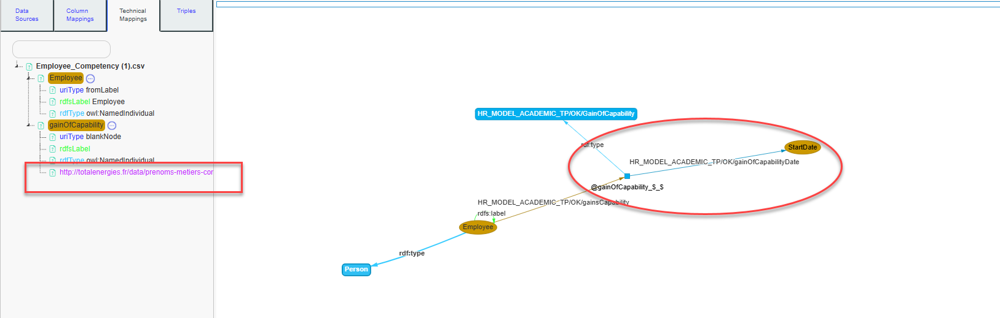

Our mappings are now complete. You can preview the triples that will be
generated.  
To do this, go to the **Triples** tab and click on **Generate
triples**.

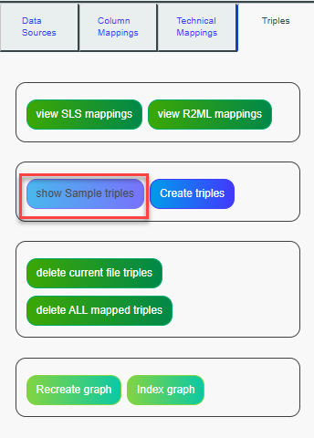

A tree will appear displaying all your mappings. You can select a
specific subset from this tree to run your mappings only on the selected
elements.

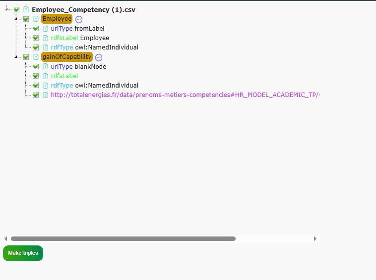

You can check all the items, then click on **show Sample**.

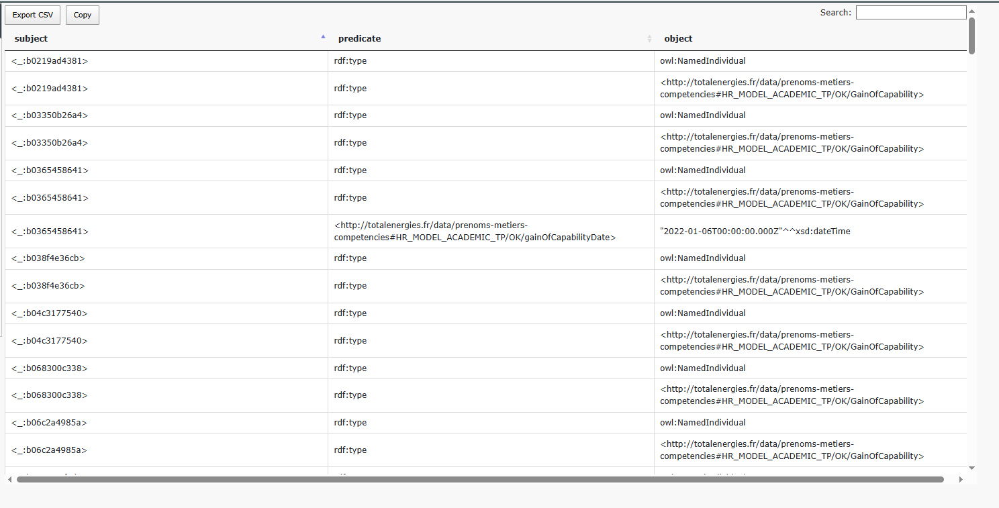

A table listing a sample of the generated triples will be displayed. We
can now analyze the information in relation to our original dataset.

For example, let's take the row corresponding to the employee *Yanis* in
our data sheet.

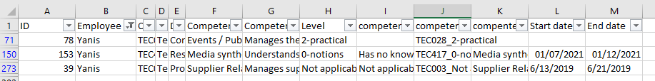

We can see that the data describes *Yanis* as having three rows, each
corresponding to a different competency he acquired, with distinct
acquisition dates.

To explore this further, search for *Yanis* in the sample table.


We observe that *Yanis* is defined as an individual of type *Person*,
with the label *Yanis*. This reflects the detailed mappings we
previously configured, where:

- The **URI** is generated using the Employee column value (*Yanis*),

- The **rdf:type** is set to owl:NamedIndividual,

- The **rdfs:label** is set using the Employee column as well.


We also see that he gains **3 capabilities**, corresponding to the **3
rows** in the data sheet.

This is the result of the mapping where:

- The **Employee** node is linked to the **gainOfCapability** virtual
  column using the gainsCapability object property.

- Each row creates a new instance (a blank node) of the
  **gainOfCapability** class.

- The **gainsCapability** property connects *Yanis* to each of these
  capability gain events.


We can now search for **one capability acquired by Yanis** in the sample
triples table, to view the corresponding triple.


We can see that this capability is represented as a blank node due to
its URI pattern. Additionally, we observe that it is of type
**individual** and **gainOfCapability**.


We can also see the datatype property we added, linking the
gainOfCapability event to the corresponding **startDate** value in the
data.

After verifying the mappings with **show Sample**, you can write the
triples in the source with the **Save in tripleStore** button, under the
same list of the **Triples** tab. You can also download them with
**Export NT**.

### Add Data source: Databases

To import data for creating a knowledge graph from a database, you need
to contact an administrator to configure your database in the **Config
Editor** tool.


Then, go to the **Mapping Modeler** tool, open the **Data Sources** tab,
right-click on **databaseSources**, choose **addDatabaseSources**, then
pick your database in **Select database**.


Once your database is added, it appears under **databaseSources**. Click on one of the database table to set it as the current data
source for mapping.

### Import classes

If you have a data source containing two columns, each representing a
class, and you want to create classes from this file


An asset is a class, and an element is a subclass of this asset, also
defined as a class. For example, an AI model is a Business Asset, and
both are classes.

To do this, select the Column Mappings tab, then click on
Asset.

Do not select a class from the list. Instead, click again on **Column**
in the legend, and then choose Element.


Ctrl + click on Element, then Ctrl + click on Asset, and choose
rdfs:subClassOf.


Then select the Technical Mappings tab. For both of them, designate them
as owl:Class for rdf:type, fromLabel for URI syntax, and set their
rdfs:label to themselves.


After filling out and saving both, here are the detailed mappings.


Preview the results by selecting the Triples tab, clicking on
**Generate triples**, then **show Sample**.

The class triples will be generated along with their
hierarchy

### Add transform 

Transforms allow you to apply JavaScript functions to each row of a
column.

For example, in our tutorial source HR\_MODEL\_ACADEMIC\_TP, we want to
add a prefix to the URI by adding 'employee-' before each label for
better clarity.

To do this, select the Technical Mappings tab, then choose Employee and
click on **More mappings...**.


In the assistant, choose **add transform**. The **Transform for Employee**
window opens: click on **prefix URI** and type 'Employee'.


A JavaScript function will be auto-filled with instructions for
prefixing the URI: the prefix is followed by '-'. If you click on **Test**,
you will see a sample of the triples produced with the added transform.
Click on **Save** to keep it.

All Employee URIs are now prefixed with 'Employee-'. Transforms can
handle multiple transformations using JavaScript. The JavaScript
function will be applied to all SLS mappings related to the column. To
check the result, use **Generate triples**, then **show Sample**, in the
Triples tab.

The SLS API for triple construction will apply the JavaScript function
to each value in the column and for each mapping related to that column.


The parameters of this function will be as follows:

- **Value**: The value of the column (e.g., the values from the Employee
  column).

- **Role**: The role of the current SLS mapping for the Employee column,
  either as Subject(s), Predicate(p), or Object(o).

- **Prop**: The property used in the current SLS mapping (useful for
  applying transforms only with specific property values).

- **Row**: The current row (e.g., row\[‘Col1’\] provides the value of
  col1 in the current row).

- **Mapping**: The current SLS mapping.

You can edit or delete a transform by right-clicking it in the tree of
the Technical Mappings tab: **edit transform** or **delete**.


### Add Lookup

Lookup replaces a column value with the value from another column, which
can be from a different data source. Given the following data
sheet.

The **CFIHOSUniqueCode** column provides a unique code for each
**tagClassName** value. However, the **parentTagClassName** column does
not have a code associated with it. A **Lookup** operation will fix this
by, for each **parentTagClassName** value, finding the corresponding row
in the **tagClassName** column and assigning the corresponding
**CFIHOSUniqueCode** value from the matching row.

For example, if the **parentTagClassName** is **actuator**, the lookup
will search for the **tagClassName** with the value **actuator** and
replace each occurrence of **actuator** in **parentTagClassName** with
**CFIHOS-30000607** (the corresponding **CFIHOSUniqueCode** for that
tagClassName).


This lookup action can be applied to another data source. It can also be
used exclusively for the column acting as the subject, the column acting
as the object, or both.

To add a lookup, first select the column that will be replaced by the
lookup in the Technical Mappings tab, then click on **More mappings...**.


Then **add LookUp**. The lookup is named after the table and the column.


In **Select DataSource**, choose the data source that contains the common
values with your column (in this example tagClassName). For a database,
**Select DataTable** then asks for the table.


In **Select Source Column for the LookUp**, choose the column containing
the common values.


In **Select Target Column for the LookUp**, choose the column whose
values will replace the values of your column.


Select whether the lookup (value replacement) will be applied when the
chosen column (parentTagClassName) is used as the subject, the object,
or both in the mapping.


The lookup is now saved. You can edit or remove it by right-clicking on
it in the tree of the Technical Mappings tab: **edit lookup** or **delete**.


Here are the resulting triples for this lookup (**Generate triples**,
then **show Sample**).


The URIs now correctly use the CFIHOS codes obtained through the lookup,
while the rdfs:label—in cases where parentTagClassName is used as an
object—still reflects the original column values.

### Use column as property for triples

Work in progress