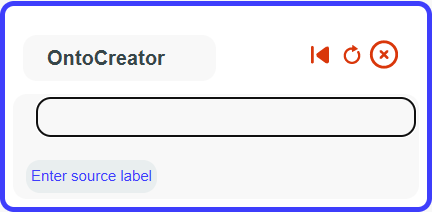
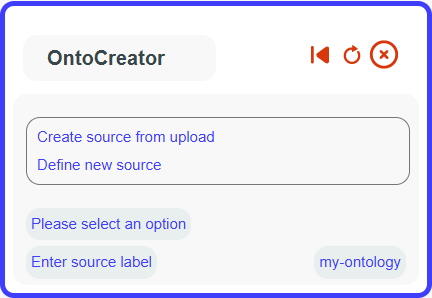
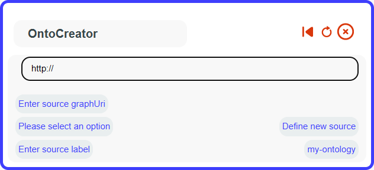
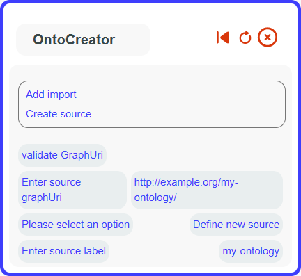
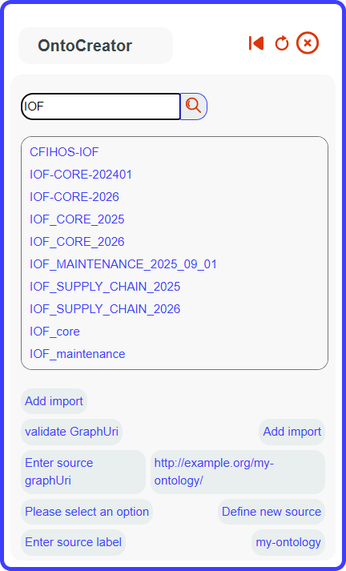

# OntoCreator

**OntoCreator** creates a new, empty OWL source that you own. You name it, give it a graph URI and, if you want, import other sources, describe it and upload a graph. Then you open it in Lineage or in MappingModeler.

```{contents} Table of Contents
:depth: 2
```

## Before you start

OntoCreator is not available to everyone:

- The tool must be in the **allowed tools** of your profile.
- Your profile must allow **source creation** (`allowSourceCreation`), and the number of sources you already own must be lower than its limit (`maxNumberCreatedSource`, 2 by default). Administrators have no limit. See [Access rights and quotas](../administration/rights-and-quotas.md).

If creation is refused, OntoCreator shows the reason instead of the questions:

- `Your profile does not allow creating sources.`
- `You already own N sources, your profile allows M. Delete one in UserSettings > Sources, using the trash icon, to create a new one.`

## Create a source

Select **OntoCreator** in the **Tool** menu of the top panel. The tool is a short conversation: it asks one thing at a time.

1. **Enter source label.** This is the name of the source, the one you will pick in the other tools.

   

   The name must have 2 to 255 letters, digits, `-` or `_`, and start with a letter or a digit. It cannot be `admin`, and it cannot be the name of another source (the case is ignored) or of a group.

2. **Please select an option.** Choose how the source starts:

   

   - **Define new source**: you give the graph URI, the source starts empty.
   - **Create source from upload**: you already have a file that contains an `owl:Ontology`, and the tool takes the graph URI from it.

### Define a new source

3. **Enter source graphUri.** The address starts with `http://`. The tool checks that it is a valid URL. The graph URI is the name of the graph in the triple store, and the base of the URIs of the source. A graph URI already used by another source is refused for a non-administrator.

   

4. Choose what to do next:

   

   - **Add import** lists the existing sources. Click one to import it: its content is then loaded with your source in Lineage. You can import several sources, one after the other.

     

   - **Create source** creates the source.

5. After the creation, the tool offers three more steps:

   - **Upload graph**: opens the upload window to load a file into the graph of the source.
   - **Add description**: asks for an **Ontology description**, saved in the graph as a `dc:description`, in English.
   - **Finish**.

### Create a source from an upload

3. **Upload graph**, then choose your file. The file goes to a temporary graph.
4. Optionally **Add import**, then **Create source**.
5. The tool reads the `owl:Ontology` of your file and uses its URI as the graph URI. If it finds none, it asks for the graph URI: type it. The graph is then moved to its final place, and the temporary source is deleted.

## After the creation

The last choice opens the new source:

- **Launch Lineage** opens Lineage on the new source.
- **Launch Mapping Modeler** opens MappingModeler on it.
- **Add Ontology Metadata** lets you add the description of the ontology.

The source also appears in **UserSettings**, under **Sources**, where you can delete it with the trash icon.

## What is created

- A source of type OWL, stored in the SousLeSens triple store, with the graph URI you gave and the imports you chose.
- You are its **owner**, and it is **private**: it sits in your own group and is not published. To publish or share it, ask an administrator.
- The graph holds a `dc:creator` triple with your login, and your description if you wrote one. Everything else comes from the file you upload.

## When it does not work

| Message | What it means |
| --- | --- |
| `enter source name` | The label is empty. |
| `Name must contain 2 to 255 alphanum, - or _ chars, and start with an alphanum char` | The label has a forbidden character. |
| `This name is already used by another source once lowercased` | A source with this name exists. |
| `This name is already a group name` | The label is also the name of a group. |
| `graphUri is not a correct URL` | The graph URI is not a valid address. |
| `Graph ... is already declared by source ...` | Another source already uses this graph. |
| `graphUri not found in the source file, please enter it manually` | Your file has no `owl:Ontology`: type the graph URI. |
