# Version

The **Version** tool saves a source in a git repository, as numbered versions and branches. Anyone with access to the repository can then read the history of the source, compare two versions and load an old one.

It works with any git server reachable over HTTPS (GitHub, GitLab, Gitea, Bitbucket...). The screenshots use GitHub, the steps are the same elsewhere.

## Contents

```{contents} Table of Contents
:depth: 2
```

## Before you start

You need:

- a source that you can edit (**readwrite** access) and that is stored in the SousLeSens triple store,
- an **empty or existing git repository**, created on your git server,
- an **access token** of your account on that server, with write access to the repository. See [Getting an access token](#getting-an-access-token).

## Open the tool

In Lineage, click the arrow next to the name of the source in the top panel, then **Version**.

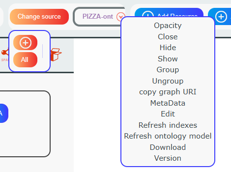

The **Version** entry only appears when the source is readwrite and stored in the SousLeSens triple store.

## Save a version

The tool is a short conversation. It asks one thing at a time.

1. **Repository URL.** Paste the HTTPS address of the repository, for example `https://github.com/my-org/ontologies-versions.git`. This is asked once: the address is then kept in the source and reused next time. **Change the repository** lets you point the source to another one.

   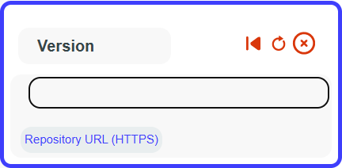

2. **Access token.** Paste your token. It is used to check that you can write to the repository, and to send your files. It is **never stored**: it is forgotten when you close the dialog.

   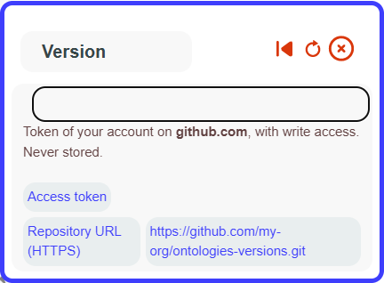

   Some git servers also ask for the user name that goes with the token. The tool asks for it only when the server refuses the token alone.

3. **What do you want to do?** Choose **New version**.

   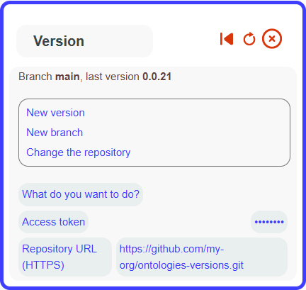

   The message above the list shows the main branch of the repository and the last version already saved.

4. **Version number.** The tool shows the current version and the numbers that can follow it. Type the new version, for example `0.0.22`. See [Version numbers](#version-numbers).

   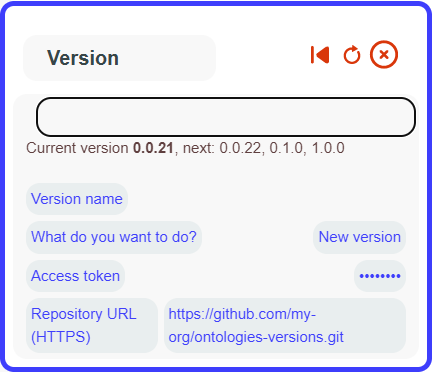

5. **Description.** Say what changed in this version, in a few words. It is optional, but it is what people read in the history. See [Where the description goes](#where-the-description-goes).

6. **Send to the repository?** The tool shows what will be sent: the number of triples of the source, and the lines added and removed compared with the repository. Choose **Send**.

   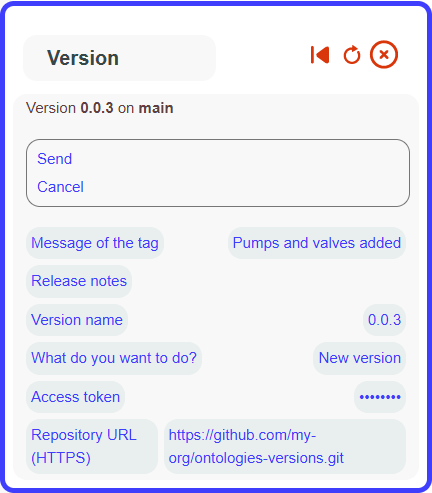

7. The tool answers with the tag it created and the commit.

   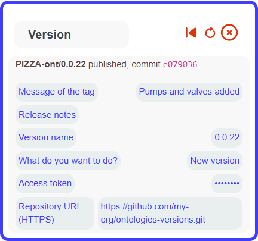

   The version number is also written in the graph, as `owl:versionInfo` (see the **MetaData** entry of the source popup).

## Version numbers

Version numbers follow [Semantic Versioning](https://semver.org): three numbers separated by dots, `MAJOR.MINOR.PATCH`.

| Example | Valid |
| --- | --- |
| `1.2.0` | yes |
| `0.0.22` | yes |
| `2.0.0-rc.1` | yes, a pre-release |
| `v1.2.0` | no, no letter before the first number |
| `1.2` | no, three numbers are needed |

A new version must always be **higher** than the last one. Each number is compared as a whole number, not as a decimal: `0.0.21` is higher than `0.0.3`, because 21 is greater than 3. After `0.0.21`, the next versions are `0.0.22`, `0.1.0` or `1.0.0`.

If the number does not follow the rules, the tool says why and asks again.

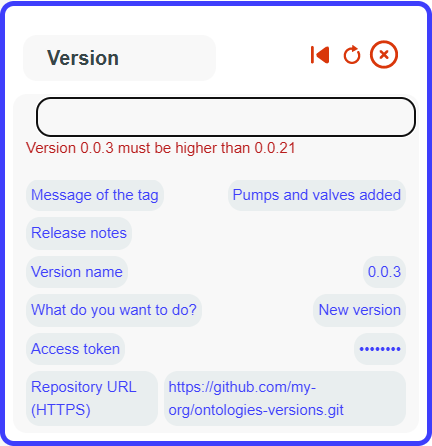

## Where the description goes

The description you type is kept in three places of the repository, so it can be found without opening SousLeSens:

- the **message of the tag** of the version,
- the **message of the commit**, which GitHub shows next to the folder of the source,
- the file **`CHANGELOG.md`** in the folder of the source, one entry per version.

An entry of the changelog looks like this:

```
## [0.0.22](https://github.com/my-org/ontologies-versions/releases/tag/PIZZA-ont%2F0.0.22) (2026-11-17)

Pumps and valves added

[Changes since the previous version](https://github.com/my-org/ontologies-versions/compare/PIZZA-ont%2F0.0.21...PIZZA-ont%2F0.0.22)
```

The title of the entry links to the tag, and the second link shows what changed since the previous version. The links are written for repositories on GitHub. On another git server, the changelog has no links.

## What the repository contains

For each source, a folder named after the source holds:

| File | Content |
| --- | --- |
| `<source>.ttl` | the triples of the source, in Turtle |
| `<source>.source.json` | the description of the source, without the access rights nor the credentials of its SPARQL server |
| `CHANGELOG.md` | the history of the versions |

A version is a **tag** named `<source>/<version>`, for example `PIZZA-ont/0.0.22`. The **main branch** always holds the last version.

## Branches

The other choices of the first question work on a **branch** named `<source>/<branch>`, to try a change without touching the main branch:

- **New branch** saves the current source on a new branch.
- **Update a branch** saves the current source on a branch that already exists. It appears when the repository has at least one branch.

Both ask for a commit message and show what will be sent before asking for confirmation.

## Getting an access token

A token is a long password, created for one purpose. It lets SousLeSens write to the repository in your name, without knowing your account password. Create it on your git server, with the rights below, and paste it in the tool.

The steps below are for **GitHub**. On another server, look for *personal access token* (or *access token*) in your account settings, and give it write access to the repository contents.

### Which token?

- **The repository belongs to an organization: use a classic token** (option 1). It works as soon as your account has **write access to the repository**, and the organization authorizes it if it uses single sign-on (SSO).
- **The repository belongs to your own account**: a fine-grained token (option 2) is possible. It is limited to the repositories you choose, which makes it safer. A classic token works too.

A fine-grained token is **not advised for a repository of an organization**: the owners of the organization must have enabled fine-grained tokens, and they often have to approve each token, which only an owner can do. Until then the tool answers `Write access to repository not granted` (error 403), even with a correct token.

### Open the token page

1. On GitHub, click your picture at the top right, then **Settings**.

   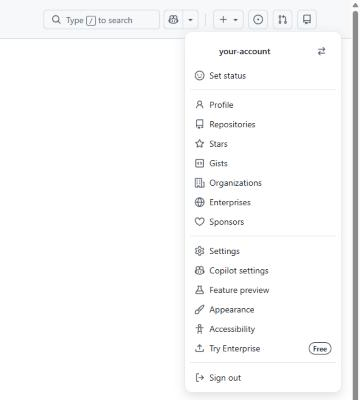

2. At the bottom of the menu on the left, open **Developer settings**.

   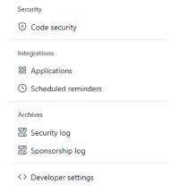

3. Open **Personal access tokens**. It offers **Tokens (classic)** and **Fine-grained tokens**.

   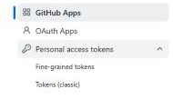

### Option 1: classic token

1. Click **Tokens (classic)**, then **Generate new token**, then **Generate new token (classic)**.
2. Give it a name and an expiration date. Tick only the **repo** scope.

   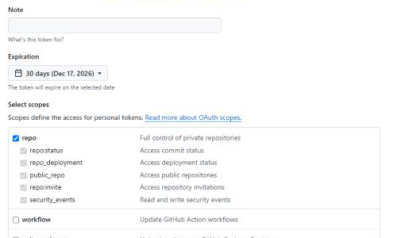

3. Click **Generate token**. Copy the token now, GitHub shows it only once.
4. If the organization uses single sign-on (SSO), click **Configure SSO** next to the token, then **Authorize** the organization. Without this step the token cannot write to the repositories of the organization.

Some organizations forbid classic tokens. An owner of the organization has to allow them, or to enable fine-grained tokens.

### Option 2: fine-grained token

1. Click **Fine-grained tokens**, then **Generate new token**.

   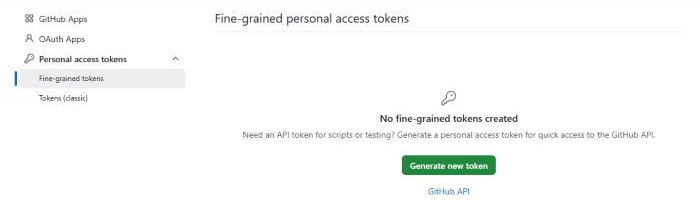

2. **Resource owner**: choose your account. This choice is made when the token is created and cannot be changed afterwards. The list only contains the organizations where fine-grained tokens are enabled, which is why an organization is often missing.

   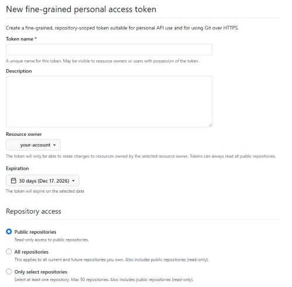

   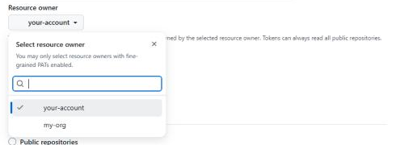

3. **Repository access**: choose **Only select repositories** and pick the repository, or **All repositories**.
4. **Permissions**, **Repository permissions**: click **Add permissions**, pick **Contents**, and set it to **Read and write**. **Metadata** is added automatically as read-only. Nothing else is needed.

   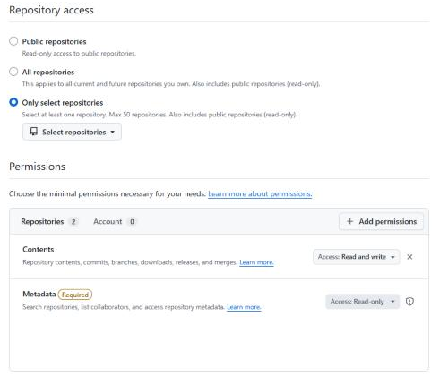

5. Choose an expiration date, then **Generate token**. Copy the token now, GitHub shows it only once.

If the repository belongs to an organization, the token may stay *pending* until an owner of the organization approves it. A repository administrator cannot approve it.

### Keep it safe

- A token is as powerful as a password for that repository. Do not share it and do not write it in a document.
- SousLeSens never stores it. It is sent only to the git server of the repository.
- If a token leaks, delete it in your account settings: it stops working at once.

## When it does not work

| Message | What it usually means |
| --- | --- |
| `Write access to repository not granted` or error 403 | The token cannot write to this repository. Check that your account has **write access** to the repository itself. For a classic token, check that it has the **repo** scope and that SSO is authorized for the organization. For a fine-grained token, check the resource owner, the selected repositories, **Contents** set to **Read and write**, and whether an owner has to approve the token. |
| `The git server refused the token, or the user name given with it` | The token is wrong, expired or revoked. The tool also asks for your user name on the git server: enter it and try again. |
| `... must be higher than ...` | The version is not higher than the last one. See [Version numbers](#version-numbers). |
| `... is not a valid version` | The number does not follow `MAJOR.MINOR.PATCH`. |
| **Version** is missing from the source popup | The source is not readwrite for you, or it is not stored in the SousLeSens triple store. |
